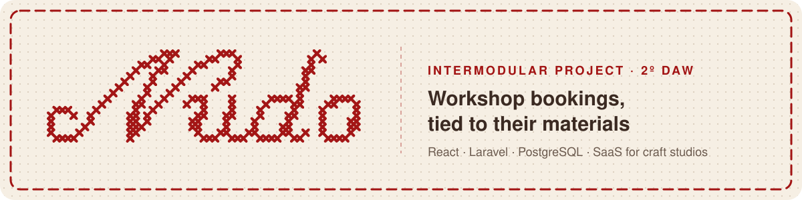

  

  
  
  
  
  
  

### 👋 About

This organization holds my **Intermodular Project** for the first year of the Web Application Development program (DAW, 2025/2026): a **resource booking system** for rooms, labs, classrooms and facilities.

Each course module added one layer, and the same data model runs through all of them: designed as an E/R diagram, implemented in SQL, exposed through a documented REST API and used by a Java CRUD app.

> ➡️ **Start here: [1ro-Proyecto-Centralizado](https://github.com/PI-InesFuentes/1ro-Proyecto-Centralizado)**, the complete project in one repository.

### 🧩 What's inside

| Layer | Deliverable | Stack |
|---|---|---|
| 🗄️ Data | [E/R model](https://github.com/PI-InesFuentes/1ro-Entrega1-BRD-Modelo-E-R) → [Relational model](https://github.com/PI-InesFuentes/1ro-Entrega3-BD-Diseno-logico-El-modelo-relacional) → [Physical SQL](https://github.com/PI-InesFuentes/1ro-Entrega5-BD-Diseno-fisico-El-modelo-fisico-en-SQL) | MariaDB / MySQL |
| 🔌 API | [REST API design](https://github.com/PI-InesFuentes/1ro-Entrega7-Diseno-de-API-REST-para-tu-sistema-de-reservas) | OpenAPI 3.0 · Swagger UI |
| ☕ Backend | [Booking CRUD](https://github.com/PI-InesFuentes/1ro-Entrega9-PROGRAMACION-CRUD-Reservas) | Java 21 · JDBC · MVC + DAO |
| 🎨 Frontend | [Consultancy website](https://github.com/PI-InesFuentes/1ro-Entrega6-LMSGI-Web-Consultora-HTML-CSS) | HTML5 · CSS3 |
| 🛠️ Ops | [XAMPP setup](https://github.com/PI-InesFuentes/1ro-Entrega2-SI-Instalacion-Entorno-de-trabajo-con-XAMPP) · [NAS backups](https://github.com/PI-InesFuentes/1ro-Entrega8-COPIA-DE-SEGURIDAD-COLABORATIVA-EN-NAS) · [Git & GitHub](https://github.com/PI-InesFuentes/1ro-Entrega4-EDE-Repositorio-de-GitHub) | XAMPP · NAS · Git |

### 👩‍💻 Author

**Inés Fuentes Martínez**, UX/UI Designer & Front-End Developer
[GitHub](https://github.com/lylyam) · [LinkedIn](https://www.linkedin.com/in/ines-fuentes-martinez/)
